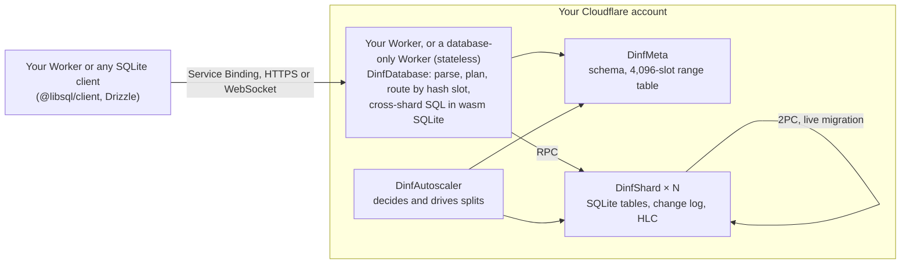

# D∞ (cf-d-infinity)

[](LICENSE)
[](https://workers.cloudflare.com/)

**An unofficial, experimental, horizontally scalable SQLite database with real transactions, running entirely on Workers and Durable Objects in your own Cloudflare account.**

Read the name as "D-infinity": the D1 API your Worker already speaks, without the single-database ceiling. Add it to a Worker with one command; the Worker plans each statement, the shards are Durable Objects holding ordinary SQLite, and there is no server to run.

> **Status: experimental.** A research prototype. Do not put data you cannot afford to lose in it; read [Limitations](#limitations) first.
>
> **License note.** The code in this repository is MIT, but it uses the GPL-2.0-or-later SQL parser [`sql-parser-cst`](https://github.com/nene/sql-parser-cst) at runtime, so a Worker bundle built with D∞ is a combined work covered by the GPL (see [license](#contributing-disclaimer-and-license)). Replacing the parser is planned.

## The idea

Sharding usually leaks into the application. It has to know the shard key, stay away from cross-shard joins and constraints, and live with statements that behave differently once rows are spread out. D∞ is built on the opposite rule: **where a row lives never changes what a statement does.**

- **A statement does the same thing wherever the rows are.** A statement that one shard can answer goes to that shard. Anything else gathers the rows it needs into a WebAssembly SQLite inside the Worker and runs the original SQL there. The fast paths are optimizations of that reference path, never a different meaning. A statement that is too big for a shard's SQLite (over 100 KB, over 100 parameters, more than five `UNION` terms) is sent to the reference path too, so Durable Object limits never decide whether it runs. What D∞ refuses or does not enforce (foreign keys, triggers) is listed under [Limitations](#limitations).
- **The guarantees do not stop at a shard boundary.** Transactions are serializable across shards, and `UNIQUE` holds across shards. Schema changes are accepted inside transactions (they commit the open transaction first, as in MySQL) and while other connections write, and they take turns with shard splits instead of racing them.
- **Refusals are decided by the statement, not by luck.** A statement is refused only for its shape, its values or the schema, with an `unsupported:` error the first time it runs. Where the rows happen to be is never the reason. The resource limits (rows and bytes gathered for one statement, bytes one transaction changes) are totals, so they do not depend on how the rows are spread either.
- **The rule is checked by machine, not only stated.**
  - The differential suites run again with every statement forced through the reference path, so a fast path that changes an answer fails. They cover random statements, compatibility scripts, typed values and concurrent statement replay.
  - Generators run the same statements on one, two and four shards: statements around the Durable Object SQLite limits, gathers and transactions around the size limits, and values that SQLite converts on the way into a key column. The outcome must not change.
  - The typed-value generators compare values together with their SQLite storage class (INTEGER and REAL included).
  - The counterexamples that the formal models find are replayed step by step against the real code in a deterministic simulator.

See it on your machine (no Cloudflare account; real workerd and Durable Objects through Miniflare):

```sh
git clone https://github.com/inaridiy/cf-d-infinity.git && cd cf-d-infinity/packages/cf-d-infinity
npm install && npm run demo
```

The demo starts with one shard. Six writers keep moving money between 200 accounts in interactive transactions, while the shards are split from 1 to 2, 4 and 8. A watcher keeps checking two things. Every snapshot must total the same amount, and an account owner, a `UNIQUE` column that the shard key does not contain, must never be reused across shards. It prints what it checked, and the transfer rate per second after the last split:

```
shards:              1 → 8, split under load
transfers committed: 3115 transactions, most of them across shards after the first split (8 conflicts retried)
after the last split: 104, 110, 102, 107, 114, 110 transfers per second; 8, 8, 7, 8, 8, 8 snapshot reads per second
snapshots checked:   192, every one totalling 20000 (0 retried during a split)
duplicates refused:  192 attempts to reuse an owner across shards
final:               total 20000, 200 accounts, 200 distinct owners

no answer changed while the data moved.
```

Distributed SQL systems such as CockroachDB, TiDB, YugabyteDB and Spanner bring transactions and SQL across many machines, for Postgres or MySQL dialects, on clusters of nodes that you or a vendor run. D∞ brings that shape to SQLite with no nodes at all. Each shard is a Durable Object holding ordinary SQLite, the query layer is your Worker, and the whole database lives in your own Cloudflare account.

## Key features

- **Interactive transactions, across shards.** `BEGIN`, read, decide, write, `COMMIT`, serializable by default, with no central timestamp oracle. D1 offers `batch()` only.
- **Works with the SQLite clients you have.** `@libsql/client` over HTTP or WebSocket, Drizzle, and a D1-compatible API. You change the URL.
- **Scales past one database.** Tables are spread over up to 4,096 hash slots, and a shard can be split online. The autoscaler watches every shard and, once you opt in with `DINF_AUTOSCALE = "split"`, splits hot or large ones itself. One shard takes ~950 single-shard writes/s; 64 shards reached 18,784 writes/s (measured on 2026-11-06 with an earlier version, [docs/benchmarks.md](docs/benchmarks.md)). Transactions that span shards are far slower: about 44–60 per second per shard (see [When not to use it](#when-not-to-use-it)).
- **SQLite semantics, not a reimplementation.** Each shard is SQLite, and cross-shard statements re-run the original SQL in a WebAssembly SQLite inside the Worker. All 8,884 queries of sqllogictest `select1`–`select5` match.
- **Pay per row, no instance to size.** Durable Object pricing: 2 billed rows per single-row `UPDATE`, $0.20 per GB-month. When nothing is happening, the only activity is the autoscaler waking each shard once a minute.
- **Checked, not only claimed.** Eighteen formal models whose counterexamples are replayed against the code, a deterministic fault-injecting simulator, differential tests against real SQLite on every execution path, and Elle-style black-box checks against production Cloudflare while Durable Objects crash and shards split.

## Quick start

> **Not on npm yet.** `cf-d-infinity` and `create-cf-d-infinity` are reserved on npm with an empty 0.0.0 placeholder; the first real release will be announced here. Until then, try D∞ from a clone of this repository (see the demo above and [Develop](#develop)).

After the first release, run `init` in a Workers project, the directory that holds your `wrangler.jsonc`. (For a project that uses the [`cf` CLI](https://developers.cloudflare.com/cf/) and `cloudflare.config.ts`, see [Wrangler and cf](#wrangler-and-cf).) The database becomes part of that Worker: its configuration lives in `wrangler.jsonc`, its version in `package.json`, and one `wrangler dev` runs both. You need Node 20 or later; local development needs no Cloudflare account.

```sh
# after the first npm release:
# npx create-cf-d-infinity@alpha init    # edits wrangler.jsonc and package.json, writes src/dinf.ts
npm install
npx wrangler dev
```

`init` adds three Durable Object classes, their migration, a Service Binding that points back at this Worker's `DinfDatabase` entrypoint, and a one-minute Cron Trigger that wakes the autoscaler. Comments in the file are kept, nothing is written if a name is already taken, and a second run changes nothing. It appends one line to your main module that re-exports the classes; the only change left to you is the `scheduled` line shown below.

```jsonc
// wrangler.jsonc (added by init; "my-app" is this Worker's own name)
"durable_objects": { "bindings": [
  { "name": "DINF_SHARD", "class_name": "DinfShard" },
  { "name": "DINF_META", "class_name": "DinfMeta" },
  { "name": "DINF_AUTOSCALER", "class_name": "DinfAutoscaler" }
] },
"migrations": [{ "tag": "cf-d-infinity-v1", "new_sqlite_classes": ["DinfShard", "DinfMeta", "DinfAutoscaler"] }],
"services": [{ "binding": "DINF_DB", "service": "my-app", "entrypoint": "DinfDatabase" }],
"vars": { "DINF_SHARD_COUNT": "8" },
"triggers": { "crons": ["* * * * *"] }    // the autoscaler watches the shards; add "DINF_AUTOSCALE": "split" to vars to let it split them
```

Use it through the binding. The binding is the credential; no token crosses it.

```ts
import { autoscale, connect } from "./dinf";

export default {
  async fetch(request: Request, env: Env): Promise<Response> {
    const db = connect(env.DINF_DB);     // D1-compatible: prepare, bind, batch, first, all, run, raw

    await db.prepare("CREATE TABLE IF NOT EXISTS accounts(id INTEGER PRIMARY KEY, balance INTEGER NOT NULL)").run();
    await db.batch([
      db.prepare("INSERT OR REPLACE INTO accounts(id, balance) VALUES (?, ?)").bind(1, 100),
      db.prepare("INSERT OR REPLACE INTO accounts(id, balance) VALUES (?, ?)").bind(2, 100),
    ]);

    const tx = await db.begin();         // BEGIN IMMEDIATE; the two rows live on different shards
    try {
      const { rows } = await tx.execute("SELECT balance FROM accounts WHERE id = ?", [1]);
      if (Number(rows[0]!.balance) < 30) throw new Error("insufficient funds");
      await tx.execute("UPDATE accounts SET balance = balance - 30 WHERE id = 1");
      await tx.execute("UPDATE accounts SET balance = balance + 30 WHERE id = 2");
      await tx.commit();                 // two-phase commit across both shards
    } catch (e) {
      await tx.rollback();
      throw e;
    }
    return Response.json((await db.prepare("SELECT id, balance FROM accounts ORDER BY id").all()).results);
  },
  scheduled: (_controller: ScheduledController, env: Env) => autoscale(env),   // called by the Cron Trigger
};

// Added by create-cf-d-infinity: wrangler.jsonc refers to these classes by name.
export { DinfAutoscaler, DinfDatabase, DinfMeta, DinfShard } from "./dinf";
```

Open <http://localhost:8787>: it returns `[{"id":1,"balance":70},{"id":2,"balance":130}]`. `npx wrangler types` gives `Env` its types. Drizzle's D1 driver takes the same object: `drizzle(connect(env.DINF_DB))`. `npx wrangler deploy` ships the app and the database together; this needs the Workers Paid plan.

## Command line

With the dev server running (`wrangler dev` or `cf dev`), the package's command talks to the database in it:

```sh
npx cf-d-infinity sql "SELECT id, balance FROM accounts ORDER BY id"
npx cf-d-infinity sql --file schema.sql          # several statements; also reads standard input
npx cf-d-infinity sql "SELECT * FROM accounts WHERE id = ?" --param 1 --json
npx cf-d-infinity slow                           # recorded slow statements, newest first
npx cf-d-infinity status                         # shards, their health, and anything that needs attention
npx cf-d-infinity export --out dump.sql          # schema and every row, as SQL
npx cf-d-infinity import dump.sql                # load such a file into an empty database
```

It needs no HTTP endpoint and no token. The command starts a throwaway local Worker with a Service Binding to your Worker's `DinfDatabase` entrypoint, calls it, and exits (under a second). It finds the Worker by the `name` in `wrangler.jsonc` or `cloudflare.config.ts`; pass `--worker <NAME>` otherwise.

Add `--remote` to run against the deployed Worker instead: `npx cf-d-infinity sql --remote "SELECT ..."`. The throwaway Worker still runs on your machine, and only its binding is a [remote binding](https://developers.cloudflare.com/workers/local-development/#remote-bindings), so nothing is deployed and nothing is exposed. This needs Wrangler in the project and `wrangler login`, takes several seconds per command, and runs the SQL on production data.

**Health.** `status` lists each shard's size, the writes still waiting for their transaction's outcome, committed transactions not yet applied everywhere, and splits in progress. It names what needs attention (for example a committed transaction that cannot be applied, with the error) and exits with code 2 when there is something, so a monitoring script can use it.

**Export.** `export` writes the DDL you ran and every row as SQL, one statement per line; `import` runs such a file. It reads shard by shard without a common timestamp, so it is not a consistent snapshot unless writes are stopped, and it refuses to run while a shard split is moving data. It is the only way to get your data out today.

**Slow statements.** A statement that takes longer than `DINF_SLOW_QUERY_MS` (a var; default 500 ms, `0` records everything, `off` disables) is recorded with its SQL text, duration, where it ran (`shard` for one shard, `gather` or `partial` for a scan gathered into the Worker, `transaction` for a batch), the number of shards it touched and its retries. Bound parameters are never recorded. The last 1,000 entries are kept, and a burst is capped at 20 entries per 10 seconds per isolate. The same list is available to your code as `env.DINF_DB.slowQueries()`.

## Wrangler and cf

D∞ works with both Wrangler and the `cf` CLI (in beta; it runs projects through Vite and reads `cloudflare.config.ts`).

| | Wrangler | cf |
|---|---|---|
| Configuration | `wrangler.jsonc`, edited by `init` | `cloudflare.config.ts`; `init` prints the block to add, because the file is a program |
| Develop and deploy | `wrangler dev`, `wrangler deploy` | `cf dev`, `cf deploy` |
| `npx cf-d-infinity ...` | works against `wrangler dev` | works against `cf dev` |
| `npx cf-d-infinity ... --remote` | works (uses Wrangler's remote bindings) | needs Wrangler installed as well |

In a cf project, `init` writes `src/dinf.ts`, re-exports the classes from your entrypoint, adds the dependency, and prints this for the `worker` in `cloudflare.config.ts`:

```ts
exports: {
  DinfShard: exports.durableObject({ storage: "sqlite" }),
  DinfMeta: exports.durableObject({ storage: "sqlite" }),
  DinfAutoscaler: exports.durableObject({ storage: "sqlite" }),
  DinfDatabase: exports.worker(),
},
env: {
  DINF_SHARD: bindings.durableObject({ worker: "my-app", exportName: "DinfShard" }),
  DINF_META: bindings.durableObject({ worker: "my-app", exportName: "DinfMeta" }),
  DINF_AUTOSCALER: bindings.durableObject({ worker: "my-app", exportName: "DinfAutoscaler" }),
  DINF_DB: bindings.worker({ worker: "my-app", exportName: "DinfDatabase" }),
  DINF_SHARD_COUNT: bindings.text("8"),
},
triggers: [triggers.scheduled({ schedule: "* * * * *" })],   // add DINF_AUTOSCALE: bindings.text("split") to env to let it split shards
```

`cf` is in beta and its configuration can change; this was checked with `cf` 1.0.0-beta.28 (`cf dev`, `cf build` and the generated types).

## Layouts and local development

| Layout | Binding in `wrangler.jsonc` | Local development |
|---|---|---|
| **Same Worker** (what `init` sets up) | `"service": "<this Worker>", "entrypoint": "DinfDatabase"` | One `wrangler dev`. Data is kept in this project's `.wrangler/state` |
| **Separate database Worker**, shared by several apps | `"service": "my-db", "entrypoint": "DinfDatabase"` | `wrangler dev -c wrangler.jsonc -c ../my-db/wrangler.jsonc` in one process, or one `wrangler dev` per project (they find each other). Data is kept in `my-db/.wrangler/state` |

For the separate layout, run `init` in an empty directory: it creates a database-only Worker. Each app then needs the one `services` line and `cf-d-infinity/client`, a few kilobytes with no database code in it:

```ts
import { connect } from "cf-d-infinity/client";
const db = connect(env.DINF_DB);
```

The Cron Trigger does not fire by itself under `wrangler dev`. To watch the autoscaler locally, start with `wrangler dev --test-scheduled` and call `curl "http://localhost:8787/__scheduled?cron=*+*+*+*+*"`.

### From outside a Worker

Node, a script or another cloud reaches the database over Hrana with a bearer token, using `@libsql/client` unchanged. The database-only Worker serves this endpoint from its default export (set `"workers_dev": true` to expose it); `init` writes dev-only tokens to its `.dev.vars`. `wss://` is cheaper per statement than `https://`.

```sh
npm install @libsql/client
node --input-type=module <<'EOF'
import { createClient } from "@libsql/client";
const db = createClient({ url: "ws://localhost:8787", authToken: "dev-only-token" });

await db.execute("CREATE TABLE IF NOT EXISTS accounts(id INTEGER PRIMARY KEY, balance INTEGER NOT NULL)");
await db.execute("INSERT OR REPLACE INTO accounts(id, balance) VALUES (1, 100), (2, 100)");

const tx = await db.transaction("write");
await tx.execute("UPDATE accounts SET balance = balance - 30 WHERE id = 1");
await tx.execute("UPDATE accounts SET balance = balance + 30 WHERE id = 2");
await tx.commit();

console.log((await db.execute("SELECT id, balance FROM accounts ORDER BY id")).rows);
db.close();
EOF
```

In production the tokens are secrets: `npx wrangler secret put DINF_API_TOKEN` for SQL and `DINF_ADMIN_TOKEN` for `/admin/*`. A route whose token is not set rejects every request.

## How it compares

Public figures as of 2026-11, from each vendor's documentation (linked below). Only the D∞ column was measured by this project; the others were not benchmarked here.

| | D∞ | Cloudflare D1 | Turso | Neon | Supabase | PlanetScale |
|---|---|---|---|---|---|---|
| Engine | SQLite | SQLite | SQLite (libSQL) | Postgres | Postgres | MySQL (Vitess), Postgres |
| Interactive transactions | Yes, across shards | No, `batch()` only | Yes | Yes | Yes | Yes |
| Writers | One per shard; shards added online | One per database | One primary per database | One primary | One primary | One primary per shard |
| Horizontal sharding | Automatic, transparent | No | No | No | No | Yes (Vitess, Neki) |
| Largest database | 10 GB per shard, up to 4,096 shards (64 tested) | 10 GB, cannot be raised | Not stated | No stated limit | 10 TB recommended on 16XL | Grows with shards |
| Write throughput | ~950/s per shard; 18,784/s on 64 shards | Single-threaded; ≤1,000 queries/s at 1 ms each | Not published | By compute size (to 56 CU) | By compute size (to 16XL) | By cluster size and shard count |
| Latency from a Worker | 31 ms read, 41 ms write p50 (Tokyo client, end to end) | In-platform binding | HTTP or WebSocket to its region | Hyperdrive or HTTP driver to its region | Hyperdrive to its region | Hyperdrive or HTTP driver to its region |
| Write price | $1.00 per million rows; 2 rows per single-row `UPDATE` | $1.00 per million rows | $1.00 per million rows over plan | Compute time, $0.106 per CU-hour | Instance, from ~$10/month plus $25 plan | Instance, from $5/month (Postgres) |
| Storage price | $0.20 per GB-month | $0.75 per GB-month | $0.75 per GB over plan | $0.35 per GB-month | $0.125 per GB-month | 10 GB included, then by region |
| Cost when idle | One probe per shard per minute while autoscaling is on; none when off | None | Plan fee | Scales to zero | Instance keeps running | Instance keeps running |
| Where it runs | Your Cloudflare account | Cloudflare | Vendor cloud | Vendor cloud | Vendor cloud | Vendor cloud |

Read it this way: against D1 you gain interactive transactions and room beyond 10 GB, and pay one extra billed row per write plus a 2PC (~13 rows) whenever a transaction spans shards. Against the Postgres and MySQL services you give up their SQL dialects, extensions and maturity, and get a database that lives next to your Worker with no instance to size.

Sources: [D1 limits](https://developers.cloudflare.com/d1/platform/limits/), [D1 pricing](https://developers.cloudflare.com/d1/platform/pricing/), [Turso pricing](https://turso.tech/pricing), [Neon plans](https://neon.com/docs/introduction/plans), [Supabase compute and disk](https://supabase.com/docs/guides/platform/compute-and-disk), [PlanetScale plans](https://planetscale.com/docs/planetscale-plans). D∞: [docs/benchmarks.md](docs/benchmarks.md).

## When not to use it

The numbers above are for a workload that partitions cleanly by a shard key. Check these before choosing D∞ over D1:

- **Under 10 GB and no need for interactive transactions: use D1.** It bills 1 row per write instead of 2, and it is faster.
- **A `UNIQUE` column or index that does not contain the shard key makes every write to that table a cross-shard commit.** `email TEXT UNIQUE` on a table sharded by `id` is the common case. Such an `INSERT` bills about 18 rows instead of 3 (measured locally on 2026-11-13), and takes a two-phase commit.
- **Cross-shard transactions are slow.** Measured on 2026-11-06 with an earlier version: 483 per second on 8 shards and 1,406 on 32 (about 44–60 per shard), p50 265–315 ms and p99 in seconds, automatic retries included.
- **A statement that reads every shard does not get faster with more shards**, and at most 200,000 rows or 16 MB (text counted as two bytes per character) can be gathered for one statement, in total over all shards. The shards stop reading once the total would exceed it and the statement fails, so a careless `SELECT *` on a large table gets an error instead of exhausting the Worker's memory. Whether it fails depends only on the size of the result, not on how the rows are spread.
- **A snapshot older than a fraction of a second can fail under write load.** A read "as of T" undoes at most 50 changed rows per shard, counted over the whole shard. A long optimistic `BEGIN` on a busy shard gets `ReadTooOld` and has to retry; the 10-minute change log is an upper bound, not what you can rely on.
- **Reads are not free of billed rows while a shard is active**: each active shard writes one clock row per second.
- **Contended writes to one shard-key group cost more on a table with an in-shard `UNIQUE`.** Before it commits, a write checks the constraint with the other pending transactions of the same group applied, in a trial that is rolled back, and rolled-back writes are billed. Each pending transaction in the same group adds about 6 billed rows and 10 statements to the write. Measured with 200 pending: 1,206 rows instead of 4. Pending transactions in other groups add nothing.

## Architecture



Rows are placed by `hash(shard key)`; the shard key defaults to the first primary-key column, and `SHARD KEY (...)` overrides it. An ordinary index is a SQLite index inside each shard. A `UNIQUE` constraint or index that does not contain the shard key is enforced across shards through an index table written in the same transaction as the row. A cross-shard commit is a two-phase commit led by one of the participating shards, ordered by per-shard hybrid logical clocks. Replication is the Durable Object storage layer's; nothing here implements Raft. The design borrows from TiDB, CockroachDB and PlanetScale; [docs/overview.md](docs/overview.md) explains the mechanisms, and [docs/design.md](docs/design.md) has the full write-up (in Japanese).

## Guarantees

| Scope | Guarantee |
|---|---|
| Single-shard transaction | Strict serializable (not verified during a Durable Object failover) |
| Multi-shard transaction | Serializable |
| Placement | The same answer as SQLite whatever the placement of rows, and whichever execution path a statement takes. Checked by running the differential suites with every statement forced through the reference path |
| Value types | INTEGER and REAL keep their storage class through every path, a split included. Hrana arguments are bound as their declared type (as in sqld), D1-API numbers as in D1 |
| Real-time order across sessions | Autocommit reads and the first read of a transaction see every write committed before they start. Later statements of a transaction may miss a newer commit on another shard. (Until 0.1.0-alpha.0 this did not hold for an autocommit read of several shards that excluded the transaction's anchor; fixed, with a regression test) |

`BEGIN IMMEDIATE` (`transaction("write")`) locks the rows it writes and the rows it reads by primary key, so a transaction that only touches rows that way rarely fails at `COMMIT`. Its other reads (by another column, scans, rows another shard holds for a `UNIQUE` check) are validated at `COMMIT` like plain `BEGIN`'s and can fail there with `SQLITE_BUSY`. Plain `BEGIN` is optimistic and can fail at `COMMIT`; retrying is the application's job.

None of the following is a proof of the implementation:

- **Formal models** ([specs/](specs/README.md)): eighteen Quint models of the risky protocol parts (the newest cover building a cross-shard `UNIQUE` index, schema changes inside transactions, table rebuilds, and the ordering of schema changes and shard splits), exhaustively checked with TLC on small instances. Each has variants with a known bug re-introduced, and TLC finds every one.
- **Model counterexamples replayed against the code**: for each of the 70 re-introduced bugs that the implementation guards against, a deterministic simulator test drives the model's counterexample against the real code. For 48 of them a fault switch also puts the bug back, and the test checks that the switch produces the violation; the other 22 replay the ordering on the fixed code only. The remaining 12 variants model design alternatives the code does not use ([the table](docs/model-coverage.md)).
- **Simulator**: the real shard code runs on `node:sqlite` under simulated delays, clock skew, restarts and splits, with a serializability checker over the history.
- **Black-box checks** (Elle-style list-append): run in the simulator and against production Cloudflare while Durable Objects are crashed, shards split and code redeployed. The latest production run (2026-11-09, before the changes since then; 10 minutes, 38 crashes, 22,798 commits) found no anomaly; earlier runs found three real bugs, including an undocumented Durable Object limit of 5 terms per compound `SELECT`.
- **Compatibility**: sqllogictest (`select1`–`select5` in full, ~174,000 further queries), differential fuzzing against real SQLite, and a generator that sends typed arguments through a stock `@libsql/client` and compares values and `typeof` with SQLite. The differential suites (not the large sqllogictest set) run three times: as planned, with every scan gathered, and with every statement on the reference path.

## Limitations

- **No point-in-time restore across shards.** Each Durable Object has its own 30-day PITR, but nothing restores all shards to one consistent point yet. `npx cf-d-infinity export` gives a logical dump, which is consistent only if writes are stopped while it runs.
- **One database, two static tokens.** No multi-tenancy, no per-user permissions.
- **Thin observability.** There is a slow-statement log (see [Command line](#command-line)), but no abort-rate or scatter-rate metrics and no tracing.
- **Unverified platform behavior.** Whether an old Durable Object instance can serve reads during failover is not documented by Cloudflare and was not tested. Clock skew between Durable Objects has no published bound.
- **SQLite differences.** Foreign keys are not enforced; `TEMP` tables, `ATTACH` and FTS5 are unavailable; an integer argument beyond 2^53 is refused over Hrana, and one computed inside SQL loses precision when it is returned; storing an INTEGER beyond ±2^53 is refused with an `unsupported:` error (the database passes values through JavaScript numbers), so keep 64-bit ids such as Snowflake ids in a TEXT column; a REAL result with an integral value (`5.0`) is returned over Hrana as an `integer`, because Durable Object SQLite does not tell the two apart when reading (`typeof()` is still exact); implicit rowids are unique but not contiguous. A stored string or BLOB is at most 2 MB (a Durable Object SQLite limit); a statement over 100 KB or with more than 100 parameters runs on the reference path instead of failing. See [docs/sql-language.md](docs/sql-language.md).
- **Refused features.** Triggers, generated columns, `CREATE TABLE ... AS SELECT`, `ALTER TABLE ... RENAME COLUMN` and `DROP COLUMN`, a collation other than `BINARY` on a primary key, a shard key or a `UNIQUE` column that does not contain the shard key, a `UNIQUE` partial or expression index that does not contain the shard key, a column whose name starts with `$` or `__dinf_` (reserved for the row-image format), a row with `NULL` in a primary key column (Drizzle's migration journal is such a table; create it first with `drizzleMigrationsTable()` from `cf-d-infinity/client`), and `sqlite_master` or a PRAGMA function inside a statement that writes are refused with an error that starts with `unsupported:`. The refusal depends only on the statement, its values and the schema, never on where rows are, so it shows up the first time the statement runs.
- **Transaction size.** What one transaction changes, old and new row images together and over all shards, must fit in 1 MB of UTF-8 (a BLOB counts twice its size). The statement that crosses the limit fails, as a statement does in SQLite, and the transaction stays open; split large changes into several transactions.
- **Schema changes inside a transaction.** A schema change inside a transaction first commits the transaction, and the statements after it form a new one, as in MySQL. `ROLLBACK` reaches back only to the last schema change, and a `batch` that contains one is split there and is no longer all or nothing. A migration that rebuilds a table (create a new table, copy the rows, drop the old one) does not lose rows that other connections write to the old table meanwhile: the drop checks for them and fails as a conflict instead, leaving the half-built new table behind, so run such a migration when the table is quiet.
- **Schema changes.** A statement that SQLite rejects is refused before it is recorded. One that fails only on rows a shard already holds (a `UNIQUE` index over duplicates, `ADD COLUMN` with a `CHECK` the rows violate) is withdrawn on every shard and reported with SQLite's message. A schema change waits up to 60 seconds for a shard split in progress and then asks to be retried; a split does not start while an index is being built. `CREATE UNIQUE INDEX` on columns that do not contain the shard key fills its index table from the existing rows inside one request, and writes to that table wait meanwhile (up to 30 seconds, then a retryable error). On a table too large to index within one request it fails and leaves the table unchanged. If the statement that builds it stops, the lock lifts within 5 seconds; a build ends after 5 minutes in any case. Names that start with `sqlite_`, and the names the database uses for its own tables (such as `__txn`, `__meta` and anything starting with `__gidx_`), are reserved.
- **Failures the caller must handle.** A transient platform error on a write is returned, not retried, because the write may already have been applied. Conflicts, stale routing and too-old snapshots are retried automatically.
- **Open items from the November 2026 design review.** There is no operator command to discard a committed transaction that can never be applied (the review's known causes are fixed, and `status` reports the state). A shard keeps one bookkeeping row per shard-key group it ever handed to another shard. The HTTP and admin entry points have not had an independent security review.
- **Scale limits.** At most 200,000 rows gathered into the Worker per statement; no hierarchical fan-out beyond 8 shards; a single hot row tops out around 650 writes/s; shards are never merged; the autoscaler notices new load within about a minute, then follows it every 5 seconds.
- **No region control.** A shard is created near the Worker that first reaches it and never moves, so latency grows with distance from there.
- **Stability.** The storage formats are listed in [docs/storage-format.md](docs/storage-format.md) and will be frozen with the first release. Data written by format 1 is kept as a test fixture that every later version must open, read, write, split and migrate. A release that does not understand a newer format refuses to open it and says so. The admin API may still change.
- **Splitting a shard cannot be undone or cancelled, so automatic splitting is opt-in.** By default the autoscaler only records that a shard should be split (`npx cf-d-infinity status` shows `would-split`); set the var `DINF_AUTOSCALE` to `"split"` to let it act. Splitting has been measured with 128 shard-key groups per shard, not with millions. A shard-key group larger than 16 MB cannot be moved, and a split that meets one stops with an error naming it. Such a split also keeps holding the maintenance slot, so every schema change waits (and after 60 seconds asks to be retried) until the group is made smaller; `status` lists the splits in progress under `splits`. A statement that reads a whole table is retried for under a second and then fails while a split is still moving data. If the process driving a split stops after the parent has fenced the moving range but before the range table points at the child, that range can be neither read nor written until the autoscaler resumes the split, which takes up to about a minute.
- **Request limits.** An HTTP body or a WebSocket message over 8 MB, and a request with more than 1,000 statements (a `/batch`, a Hrana pipeline or a Hrana batch), are refused before anything runs, with status 413 or close code 1009. A statement over 1 MB of text, a 65th stream on one socket and a 1,001st stored statement fail on their own with an error; in a Hrana pipeline the requests before them have already run. A WebSocket's `hello` must arrive within 10 seconds.
- **The schema is fetched from one Durable Object.** Each Worker isolate caches it for 2 seconds and refetches on the request path, so that object is a dependency of every request.

## Develop

```sh
git clone https://github.com/inaridiy/cf-d-infinity.git && cd cf-d-infinity/packages/cf-d-infinity
npm install
npm test              # unit, simulator and workerd tests, a few minutes, no Cloudflare account
npx wrangler dev --var DINF_API_TOKEN:dev-only-token --var DINF_ADMIN_TOKEN:dev-only-admin
```

With `wrangler dev` running, the script under [From outside a Worker](#from-outside-a-worker) works from that directory as written, and `curl -X POST http://localhost:8787/admin/status -H "authorization: Bearer dev-only-admin" -d '{}'` lists the 8 shards and the slot range each owns.

| Command (in `packages/cf-d-infinity/` unless noted) | Purpose |
|---|---|
| `npm run typecheck` | `tsc --noEmit` |
| `npm run build` | Build `lib/`, what the npm package ships |
| `test/slt/fetch.sh && SLT_LIMIT=1000000 npx vitest run test/slt.test.ts` | Download and run sqllogictest `select1`–`select5` |
| `FUZZ_SEEDS=200 FUZZ_LENGTH=150 npx vitest run test/fuzz.test.ts` | Differential fuzzing against real SQLite |
| `ROWCOST=1 npx vitest run test/rowcost.test.ts` | Check billed rows per operation |
| `npm run deploy:bench` | Deploy the separate benchmark and fault-injection build |
| `node bin/cli.js sql "SELECT 1" --worker <NAME>` | The `cf-d-infinity` command, against a dev server on this machine |
| `npm test` (in `packages/create-cf-d-infinity/`) | Tests of the setup CLI |
| `./check.sh` (in `specs/`, needs Java 17 or later) | Check all Quint models with TLC |

`packages/cf-d-infinity/` is the library, its tests and benchmarks; `packages/create-cf-d-infinity/` the setup CLI; `specs/` the Quint models; `spikes/` early experiments. [DEVELOPMENT.md](packages/cf-d-infinity/DEVELOPMENT.md) lists every HTTP endpoint and the two-step upgrade procedure (in Japanese).

## Documentation

The overview is in English; the detailed documents are in Japanese for now.

| Topic | Guide |
|---|---|
| How it works, in English | [Design overview](docs/overview.md) |
| Protocol, isolation, 2PC, recovery | [Design](docs/design.md) |
| What SQL runs where, and SQLite differences | [SQL dialect](docs/sql-language.md) |
| Live migration, autoscaling, storage | [Scaling](docs/scaling.md) |
| Statement placement and pushdown rules | [Query engine](docs/query-engine.md) |
| Every production measurement | [Benchmarks](docs/benchmarks.md) |
| Durable Object limits and prices this relies on | [Platform facts](docs/platform-facts.md) |
| Formal models and what they abstract away | [Specs](specs/README.md) |

## Contributing, disclaimer and license

Bug reports are welcome, and please open an issue before a large change; [CONTRIBUTING](CONTRIBUTING.md) lists what each kind of change needs. [SECURITY](SECURITY.md) is for vulnerability reports.

Not affiliated with, endorsed by or supported by Cloudflare or any vendor named above. "D∞" and `cf-d-infinity` are this project's own names, not a Cloudflare product; "Cloudflare", "D1" and the other vendors' names are trademarks of their owners and are used only to describe compatibility and to compare.

MIT, see [LICENSE](LICENSE). The deployed Worker bundles third-party packages under their own licenses. The SQL parser [`sql-parser-cst`](https://github.com/nene/sql-parser-cst) is **GPL-2.0-or-later**, so a built Worker bundle is a combined work covered by the GPL; if you distribute such a bundle, you must comply with it. SQLite in the Worker comes from [sql.js](https://github.com/sql-js/sql.js) (MIT).
